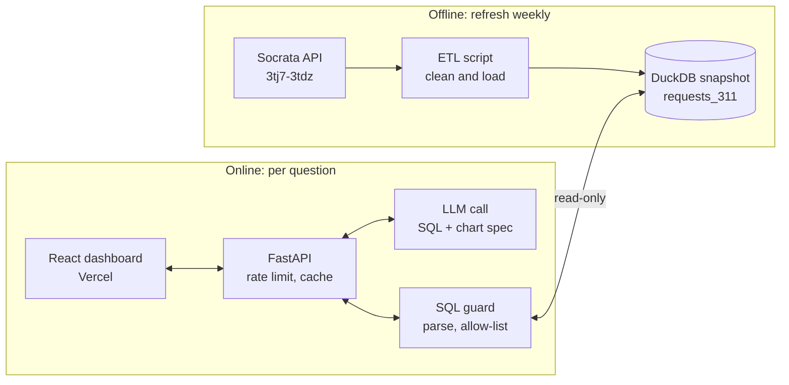

# Ask-the-city: design notes

Ask plain-English questions about Buffalo 311 service requests and get back a chart plus the SQL that produced it.

This file records the step 1 decisions (dataset, schema, demo questions, architecture). Step 2 code lives in `backend/etl/`.

## 1. Dataset

| | |
|---|---|
| Name | 311 Service Requests (May 2024 – Present) |
| Portal | Open Data Buffalo (Socrata), data.buffalony.gov |
| Dataset ID | `3tj7-3tdz` |
| URL | https://data.buffalony.gov/d/3tj7-3tdz |
| License | Public Domain U.S. Government, no login needed |
| Size | 208,788 rows, May 11, 2024 to Oct 28, 2026 (checked Oct 28, 2026); updated daily |
| Columns | 28 source fields, 179 distinct request types |

**Why this one.** Buffalo split 311 into two datasets: July 2008 – May 2024 (`whkc-e5vr`, frozen) and May 2024 – present (`3tj7-3tdz`, still updated). They use different column schemas. Merging them means mapping request types and column names across systems, which is a day of cleanup that doesn't improve the demo. v1 uses the current dataset only.

**Tradeoff.** No history before May 2024, so "since 2008" questions are out. Year-over-year still works for spring and summer.

**Why not NYC or a whole state.** NYC 311 is tens of millions of rows (breaks free-tier hosting) and is the most overused text-to-SQL tutorial dataset. 311 is run city by city with inconsistent schemas, so a "state" version is a data-cleaning project, not an AI one. If we scale, we scale sideways: a second Buffalo dataset (crime or code violations) so the model has to pick tables and join.

## 2. Schema

All 28 source fields (from the live API, Oct 28, 2026): `createddate`, `casenumber`, `department`, `division`, `type`, `status`, `statusdescription`, `closeddate`, `propertyid`, `reportedlocation`, `assessednumber`, `assessedstreet`, `street`, `secondarystreet`, `city`, `state`, `zip`, `latitude`, `longitude`, `duplicate_request`, `council_district`, `planningneighborhood`, `planningsector`, `policedistrict`, `census_tract`, `census_block_group`, `census_block`, `location`.

Cleaned table `requests_311` in DuckDB:

| Column | Type | From | Cleaning |
|---|---|---|---|
| `case_number` | VARCHAR | `casenumber` | trimmed; rows without one are dropped; deduplicated |
| `created_at` | TIMESTAMP | `createddate` | rows without one are dropped |
| `closed_at` | TIMESTAMP | `closeddate` | null if open |
| `request_type` | VARCHAR | `type` | trimmed, whitespace collapsed |
| `status`, `status_description` | VARCHAR | same | trimmed |
| `department`, `division` | VARCHAR | same | trimmed |
| `council_district`, `planningneighborhood`, `planningsector`, `policedistrict`, `census_tract` | VARCHAR | same | trimmed |
| `street`, `assessedstreet`, `city`, `state` | VARCHAR | same | trimmed (street names only, no house numbers) |
| `zip` | VARCHAR | `zip` | first 5 digits only |
| `latitude`, `longitude` | DOUBLE | same | nulled if outside a Buffalo bounding box |
| `duplicate_request` | BOOLEAN | same | as provided |
| `days_to_close` | DOUBLE | derived | `closed_at - created_at` in days; null if open or negative |

Deliberately dropped:
- **Address-level fields** (`assessednumber`, `propertyid`, `reportedlocation`, `secondarystreet`): they would pin a complaint such as noise or a housing violation to one house, and no demo question needs them.
- **`census_block`, `census_block_group`**: too fine-grained to chart; `census_tract` is kept.
- **`location`** (geo point): duplicates latitude and longitude.
- Any field that looks like a caller's name, phone or email.

Counting rule: the source flags duplicate requests, so counts exclude `duplicate_request = true` unless a question asks about duplicates.

Status values: Closed 197,812; New 6,275; In Progress 4,692; On Hold 5; Cancelled 4. Top request types: Replacement Garbage Totes Request (19,173), Garbage Missed Pick Up (14,791), Housing or Building Violations(Exterior) (14,502), General Parking Issue(s) (11,363), Pothole Issue (9,177).

## 3. Demo questions (one-click buttons)

| # | Question | Chart |
|---|---|---|
| 1 | How many 311 requests were filed each month since May 2024? | line |
| 2 | What are the 10 most common request types? | bar |
| 3 | Which council districts have the most pothole requests? | bar |
| 4 | How have missed garbage pickup requests changed month by month? | line |
| 5 | How many requests are New, In Progress, or Closed? | bar |
| 6 | Which day of the week gets the most requests? | bar |
| 7 | What hours of the day see the most requests? | bar |
| 8 | Compare pothole requests this spring vs. last spring | grouped bar |
| 9 | What's the median days-to-close by request type? | bar |
| 10 | Last 30 days vs. the 30 days before: which types grew most? | bar |

Notes:
- Exact filter values: `'Pothole Issue'` for questions 3 and 8, `'Garbage Missed Pick Up'` for question 4.
- Council districts replace ZIP codes in question 3 because they are named places a non-local reader can follow.
- "Last 30 days" and "this spring" are anchored to `max(created_at)` in the snapshot, never `now()`.
- Questions 8 and 10 are the hard eval cases (date math and comparisons).

## 4. Architecture

Design calls:
- **Snapshot, not live API queries.** Socrata's SoQL is SQL-like but not SQL. A DuckDB snapshot gives standard SQL to show users and reproducible execution-accuracy evals. The UI shows an "as of" date.
- **The LLM never sees raw rows.** It gets a generated schema card: columns, types, null rates, real category values with counts, and query rules.
- **The SQL guard does the safety work, not the prompt.** Parse with `sqlglot`, allow one `SELECT` on `requests_311`, force a `LIMIT`, run on a read-only connection with a timeout.
- **The LLM proposes a chart type; the backend validates it** against the result shape, with a deterministic fallback.
- **Demo buttons are precomputed** into static JSON on Vercel so they load instantly even when the free-tier backend is asleep. Only free-text questions hit FastAPI.

## 5. Cut from v1

Map view, pre-2024 data, multi-turn chat, auth, other datasets (until the 311 version has an eval number).

## 6. Build steps

1. Design (this file)
2. Data layer: `backend/etl/` (done)
3. Backend: FastAPI, LLM structured output, SQL guard
4. Frontend: React dashboard, demo buttons, chart + SQL panel
5. Evals: 50 hand-labeled questions, execution accuracy
6. Deploy: Vercel + free-tier backend, cost guardrails
